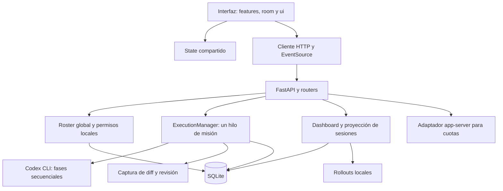

# Revisión profunda de código y arquitectura de SlimeOps

Fecha: 26 de octubre de 2026. Base revisada: `15c1137b721d996f143033955e5566e7b790097e`, con las habilidades locales de ECC añadidas en `.agents/skills/`. Este informe describe el estado anterior a aplicar sus correcciones.

El estado posterior se recoge en el [registro de correcciones](REMEDIATION_2026-10-26.md). Los enlaces de evidencia apuntan al commit revisado para conservar el diagnóstico original.

## Dictamen

La arquitectura elegida es adecuada para una aplicación local que controla una misión propia cada vez: un monolito modular con FastAPI, SQLite, procesos Codex secuenciales y una interfaz de módulos JavaScript nativos. La separación entre planificación, proceso, almacenamiento, diff y revisión ya permite mejorar el sistema por partes.

La implementación tiene defectos de seguridad, consistencia y sincronización que conviene resolver antes de ampliar las funciones. Los principales son HTML persistido que se interpreta como código, una consulta de cuotas sin plazo de respuesta y operaciones que dejan memoria y SQLite en estados distintos cuando falla una escritura. También hay problemas visibles de actualización de la interfaz y una diferencia entre fuente y artefacto desplegable.

Recomendación: conservar el monolito modular y reforzar los límites de responsabilidad, las transacciones y el flujo de estado. El escenario de referencia de este dictamen es el arranque actual en `127.0.0.1`. Una futura exposición a otros equipos exige un diseño de identidad y sesiones distinto del operador local provisional.

## Alcance y método

Se realizaron tres revisiones especializadas coordinadas: backend y API; seguridad y ciclo de vida de procesos; frontend y flujo de estado. La revisión integradora comprobó arranque, persistencia, pruebas, artefactos y coherencia de las recomendaciones. Se usaron las guías locales `python-patterns`, `api-design`, `security-review` y `project-verification` como referencias, aplicando las convenciones reales del proyecto.

Se inspeccionaron los módulos de `backend/app`, las rutas, el frontend de `frontend/src`, el artefacto `dist`, los lanzadores, las pruebas existentes y la documentación técnica. Se excluyeron el código de dependencias, los recursos gráficos originales, las credenciales del usuario y el historial completo de Git. El runtime anterior de `runtime/` se trató como referencia histórica, excepto el esquema de revisión utilizado por el ejecutor vigente.

No se modificó el código de la aplicación ni se ejecutaron misiones reales o inferencias de Codex. Las comprobaciones adicionales de API utilizaron una base SQLite temporal y fallos simulados en un proceso independiente. No se ejecutaron los ejemplos de HTML en un navegador.

### Evidencia ejecutada

| Comprobación | Resultado | Alcance práctico |
| --- | --- | --- |
| Runner conjunto `node --preserve-symlinks --preserve-symlinks-main scripts/test.mjs` | 50 pruebas backend y 19 frontend aprobadas | Pruebas existentes, con procesos locales simulados y almacenamiento temporal. |
| `npm test` directo | Bloqueado antes del runner por `EPERM` al resolver `C:\Users\Mr.River` en este sandbox | El comando anterior ejecutó el mismo script de pruebas. Este bloqueo no se atribuye a un defecto de la aplicación. |
| Alta repetida del mismo rol mediante `TestClient` | Primera petición 200; segunda 500 | Confirma H13. |
| Dashboard con un usuario sin `dashboard.view` y sin cabecera de operador | 403 con ese usuario; 200 sin cabecera | Confirma la identidad predeterminada que causa H06; no se abrió un stream infinito con el cliente de pruebas. |
| Alta de un usuario cuyo nombre contiene una etiqueta HTML con manejador de evento | Se conserva literalmente en la respuesta y SQLite temporal | Confirma la entrada y persistencia de H01; el punto de interpretación HTML se verificó en el código. |
| Fallo simulado de `save_agent_registry` durante un alta | 500; agente presente en memoria; perfil confirmado; registro ausente | Confirma H03 y su persistencia parcial. |
| Comparación por hash de JS, HTML y CSS entre fuente y `dist` | Una diferencia: `js/features/agent-watch.js` | Confirma H12. No se reconstruyó `dist` durante la auditoría. |

La suite emitió una advertencia de compatibilidad de `fastapi.testclient` sobre su transporte HTTP. Los tests aprobaron; conviene registrar y fijar las versiones antes de futuras actualizaciones. No se midieron cobertura porcentual, latencias bajo carga ni consumo de memoria.

## Arquitectura observada

El límite de una misión propia se aplica al runtime asociado a una base de datos. No garantiza exclusión frente al editor, otras sesiones externas o otro runtime que use otra base y apunte al mismo workspace.

## Decisiones que conviene conservar

- FastAPI, SQLite y un worker encajan con el uso local y el tamaño actual.
- `main.py` compone la aplicación y gestiona el ciclo de vida; los módulos no crean el esquema al importarse.
- `RuntimeLease` evita dos runtimes sobre la misma base. La recuperación marca misiones interrumpidas sin repetirlas automáticamente.
- La idempotencia por `request_id`, los reintentos manuales y la copia de modelo/esfuerzo al crear la misión reducen efectos inesperados.
- Solo FORGE recibe escritura. Los procesos usan listas de argumentos; los diffs comprueban contención de rutas y enlaces, acotan contenido y aplican redacción defensiva.
- Se evita publicar razonamiento privado y salidas crudas de herramientas en la telemetría.
- El cálculo de salud operativa es una función pura y separa ocupación de presupuestos orientativos.
- El historial pide resúmenes y carga resultados y diffs bajo demanda. La simulación visual está diferenciada del trabajo real.

## Hallazgos priorizados

P1: corregir en la primera etapa. P2: defecto relevante o riesgo de integridad para la siguiente etapa. P3: robustez o precisión con menor urgencia. «Estático» significa que se trazó el comportamiento en el código; no implica que se haya reproducido en navegador o bajo carga.

| ID | Prioridad | Hallazgo | Evidencia |
| --- | --- | --- | --- |
| H01 | P1 | HTML persistido se interpreta en gestión de accesos | Persistencia ejecutada y puntos de render estáticos |
| H02 | P1 | La lectura de cuotas puede bloquearse indefinidamente | Estática; ruta sin timeout |
| H03 | P2 | Escrituras parciales entre memoria, perfil, registro y ejecución | Fallo de alta reproducido; transiciones de consumo estáticas |
| H04 | P2 | Las mutaciones concurrentes del roster carecen de exclusión coherente | Estática |
| H05 | P2 | El generador SSE ejecuta I/O bloqueante en el event loop | Estática; impacto temporal sin medir |
| H06 | P2 | SSE usa superadministrador aunque cambie el operador | Identidad predeterminada reproducida y transporte estático |
| H07 | P2 | Respuestas antiguas pueden sobrescribir el estado o workspace vigente | Estática; escenario de respuestas fuera de orden |
| H08 | P2 | El DOM conserva agentes borrados y puede duplicar tarjetas | Estática |
| H09 | P2 | Un perfil rechazado se presenta como guardado local | Estática |
| H10 | P2 | Un refresco del historial destruye resultados y diffs abiertos | Estática |
| H11 | P2 | Altas de usuarios y roles no actualizan los botones CRUD | Estática |
| H12 | P2 | `dist` conserva porcentajes de tokens retirados de la fuente | Comparación ejecutada |
| H13 | P2 | Una colisión de usuario o rol devuelve 500 | Rol duplicado reproducido |
| H14 | P3 | La validación permite texto vacío después de recortar espacios | Estática |
| H15 | P2 | El historial solo permite descubrir las últimas 20 misiones | Estática |
| H16 | P2 | El diff de misión puede incluir escrituras externas | Estática; condición de trabajo concurrente |
| H17 | P2 | El monitor limita sesiones antes de filtrar el proyecto | Estática |
| H18 | P3 | La serie temporal de uso depende de las consultas del panel | Estática |

### H01 · HTML persistido en la gestión de accesos

Referencias: [access.js:31](https://github.com/MrRiver94/Panel-de-control-de-agentes/blob/15c1137b721d996f143033955e5566e7b790097e/frontend/src/js/features/access.js#L31), [access.js:62](https://github.com/MrRiver94/Panel-de-control-de-agentes/blob/15c1137b721d996f143033955e5566e7b790097e/frontend/src/js/features/access.js#L62), [models.py:68](https://github.com/MrRiver94/Panel-de-control-de-agentes/blob/15c1137b721d996f143033955e5566e7b790097e/backend/app/models.py#L68), [access.py:42](https://github.com/MrRiver94/Panel-de-control-de-agentes/blob/15c1137b721d996f143033955e5566e7b790097e/backend/app/routes/access.py#L42).

Los nombres de usuarios y roles y los permisos se interpolan en `innerHTML` o `insertAdjacentHTML`. La API conserva el contenido como texto, pero la vista lo interpreta como HTML. Un nombre como `` cabe en el límite de 42 caracteres de usuario. El almacenamiento literal se confirmó con SQLite temporal.

Impacto: el código inyectado se ejecutaría con el origen del panel local y podría usar sus capacidades de API, incluida la creación de misiones si el runtime está disponible. La instalación en loopback no demuestra por sí sola una vía de entrada remota: el escenario requiere introducir el valor en datos persistidos de acceso.

Corrección: construir nodos y asignar `textContent` para todos los valores variables, también nombres de agentes y permisos; reservar plantillas HTML para contenido fijo. Validar las capacidades de un rol contra el catálogo admitido.

Criterio de cierre: nombres con etiquetas, comillas y manejadores de eventos se muestran literalmente en árbol, selectores y acciones; una regresión DOM comprueba que no se crean elementos ejecutables.

### H02 · Consulta de cuotas sin plazo de respuesta

Referencias: [codex_usage.py:22](https://github.com/MrRiver94/Panel-de-control-de-agentes/blob/15c1137b721d996f143033955e5566e7b790097e/backend/app/codex_usage.py#L22), [codex_usage.py:37](https://github.com/MrRiver94/Panel-de-control-de-agentes/blob/15c1137b721d996f143033955e5566e7b790097e/backend/app/codex_usage.py#L37), [codex_usage.py:61](https://github.com/MrRiver94/Panel-de-control-de-agentes/blob/15c1137b721d996f143033955e5566e7b790097e/backend/app/codex_usage.py#L61), [api.js:6](https://github.com/MrRiver94/Panel-de-control-de-agentes/blob/15c1137b721d996f143033955e5566e7b790097e/frontend/src/js/services/api.js#L6).

`read_app_server_response()` espera en `stdout.readline()` mientras mantiene `codex_usage_lock`. Si el proceso permanece vivo sin responder, nunca se alcanza el fallback ni el bloque de limpieza. El timeout HTTP del navegador no cancela ese hilo del servidor. Las siguientes consultas esperan el mismo lock y pueden consumir progresivamente los hilos disponibles para rutas síncronas. Además, la limpieza usa `terminate()` y `wait(timeout=3)` sin eliminación forzosa de respaldo.

Corrección: aplicar un plazo total al intercambio con app-server, cerrar las tuberías y garantizar terminación del proceso; acotar también la espera de refresco y servir datos cacheados con antigüedad explícita cuando sea necesario.

Criterio de cierre: un proceso simulado que no contesta o ignora la terminación no deja peticiones ni locks bloqueados, y una consulta posterior puede recuperarse.

### H03 · Persistencia parcial de agentes y transiciones de ejecución

Referencias: [agents.py:82](https://github.com/MrRiver94/Panel-de-control-de-agentes/blob/15c1137b721d996f143033955e5566e7b790097e/backend/app/routes/agents.py#L82), [repository.py:117](https://github.com/MrRiver94/Panel-de-control-de-agentes/blob/15c1137b721d996f143033955e5566e7b790097e/backend/app/repository.py#L117), [repository.py:93](https://github.com/MrRiver94/Panel-de-control-de-agentes/blob/15c1137b721d996f143033955e5566e7b790097e/backend/app/repository.py#L93), [execution.py:130](https://github.com/MrRiver94/Panel-de-control-de-agentes/blob/15c1137b721d996f143033955e5566e7b790097e/backend/app/execution.py#L130), [execution.py:156](https://github.com/MrRiver94/Panel-de-control-de-agentes/blob/15c1137b721d996f143033955e5566e7b790097e/backend/app/execution.py#L156).

El alta publica primero el objeto en `state.agents`, confirma `agent_profiles`, confirma `agent_registry` y registra auditoría en operaciones separadas. Se reprodujo un fallo después del commit del perfil: la API devolvió 500, el agente siguió en memoria y el registro recuperable no existía. Tras reiniciar, un perfil huérfano no recrea el agente.

Los controles también mutan el objeto compartido antes de confirmar la escritura. Un `turn.completed` confirma consumo, registro del agente y snapshot de ejecución por separado; una caída intermedia puede dejar auditoría y contador recuperado en desacuerdo.

Corrección: una transacción por operación lógica o transición relevante que incluya configuración, auditoría y proyecciones persistidas necesarias; publicar una copia validada en memoria después del commit. Elegir una única fuente persistente para el perfil. Usar un identificador de evento si se reintenta guardar una transición.

Criterio de cierre: inyectar fallos entre cada etapa y reiniciar; la operación se conserva completa o no se aplica, sin agentes fantasma ni consumo divergente.

### H04 · Carreras sobre el roster compartido

Referencias: [agents.py:75](https://github.com/MrRiver94/Panel-de-control-de-agentes/blob/15c1137b721d996f143033955e5566e7b790097e/backend/app/routes/agents.py#L75), [agents.py:97](https://github.com/MrRiver94/Panel-de-control-de-agentes/blob/15c1137b721d996f143033955e5566e7b790097e/backend/app/routes/agents.py#L97), [dashboard.py:66](https://github.com/MrRiver94/Panel-de-control-de-agentes/blob/15c1137b721d996f143033955e5566e7b790097e/backend/app/routes/dashboard.py#L66), [repository.py:114](https://github.com/MrRiver94/Panel-de-control-de-agentes/blob/15c1137b721d996f143033955e5566e7b790097e/backend/app/repository.py#L114).

Las rutas síncronas pueden ejecutarse en distintos hilos. El lock de SQLite no abarca la selección de identificadores ni las mutaciones de `state.agents`. Dos altas del mismo nombre pueden elegir simultáneamente el mismo ID y sobrescribirse mediante `INSERT OR REPLACE`. Dos bajas pueden superar la comprobación de existencia antes de que una provoque un `KeyError`. El dashboard también puede iterar el diccionario mientras cambia su tamaño.

Corrección: un servicio de roster dueño de las mutaciones y snapshots coherentes para los lectores; reservar IDs con una restricción única y un reintento controlado de sufijo. Coordinarlo con la transacción de H03.

Criterio de cierre: pruebas con barreras que fuercen altas/bajas simultáneas no pierden objetos ni producen 500; los lectores reciben snapshots completos.

### H05 · I/O síncrono dentro del stream asíncrono

Referencias: [dashboard.py:81](https://github.com/MrRiver94/Panel-de-control-de-agentes/blob/15c1137b721d996f143033955e5566e7b790097e/backend/app/routes/dashboard.py#L81), [external_monitor.py:39](https://github.com/MrRiver94/Panel-de-control-de-agentes/blob/15c1137b721d996f143033955e5566e7b790097e/backend/app/external_monitor.py#L39), [codex_sessions.py:28](https://github.com/MrRiver94/Panel-de-control-de-agentes/blob/15c1137b721d996f143033955e5566e7b790097e/backend/app/codex_sessions.py#L28).

El generador `async` de SSE llama directamente a `dashboard_snapshot()`. Ese camino adquiere locks de hilos, consulta SQLite y puede recorrer y leer rollouts. Si un lock o disco tarda, se bloquea el event loop del único worker, retrasando otras tareas asíncronas y la recepción de nuevas solicitudes. No se midió la latencia real.

Corrección inicial: sacar la obtención del snapshot a un hilo. Evolución recomendable: una proyección compartida producida fuera del generador y distribuida a las conexiones, evitando reconstruirla por cliente.

Criterio de cierre: demorar deliberadamente la lectura de datos no impide atender salud ni aceptar cancelaciones dentro de un plazo definido.

### H06 · Identidad incoherente entre HTTP y SSE

Referencias: [live.js:69](https://github.com/MrRiver94/Panel-de-control-de-agentes/blob/15c1137b721d996f143033955e5566e7b790097e/frontend/src/js/services/live.js#L69), [permissions.py:21](https://github.com/MrRiver94/Panel-de-control-de-agentes/blob/15c1137b721d996f143033955e5566e7b790097e/backend/app/permissions.py#L21), [access.js:189](https://github.com/MrRiver94/Panel-de-control-de-agentes/blob/15c1137b721d996f143033955e5566e7b790097e/frontend/src/js/features/access.js#L189).

`EventSource` se crea sin `X-Operator-Id`; el backend interpreta una cabecera ausente como `super-admin`. Cambiar el usuario no recrea ni revoca el stream. Un usuario sin `dashboard.view` puede recibir por SSE el dashboard que su petición HTTP ordinaria tiene prohibido. Se comprobó el contraste 403 con usuario limitado y 200 sin cabecera.

Corrección: definir cómo transporta y valida la identidad el stream y hacer coherente su ciclo de vida con el cambio de operador. Si se conserva provisionalmente una identidad declarativa local, debe tratarse como tal y fallar de forma explícita ante su ausencia; no es autenticación. Una identidad enviada en URL tampoco resolvería la autenticación.

Criterio de cierre: un operador sin permiso no recibe snapshots por ningún transporte; cambiarlo invalida conexiones y respuestas pendientes de la identidad anterior.

### H07 · Aplicación de snapshots fuera de orden

Referencias: [app.js:44](https://github.com/MrRiver94/Panel-de-control-de-agentes/blob/15c1137b721d996f143033955e5566e7b790097e/frontend/src/app.js#L44), [live.js:57](https://github.com/MrRiver94/Panel-de-control-de-agentes/blob/15c1137b721d996f143033955e5566e7b790097e/frontend/src/js/services/live.js#L57), [live.js:1](https://github.com/MrRiver94/Panel-de-control-de-agentes/blob/15c1137b721d996f143033955e5566e7b790097e/frontend/src/js/services/live.js#L1).

Polling y SSE aplican snapshots al mismo estado. Las consultas HTTP pueden solaparse y no comprueban generación de workspace/operador ni revisión monotónica del snapshot. Una respuesta de A que llegue después de seleccionar B puede volver a representar A. Una respuesta HTTP anterior también puede sobrescribir datos más recientes del stream.

Corrección: cancelar consultas al cambiar el contexto, etiquetarlas con su generación y descartar respuestas antiguas; incorporar una revisión de snapshot compartida entre transportes. Usar polling como respaldo cuando SSE esté sano reduce el problema y el trabajo duplicado.

Criterio de cierre: resolver respuestas artificialmente en orden inverso o después de cambiar proyecto/operador no revierte el estado vigente.

### H08 · Agentes fantasma y tarjetas duplicadas

Referencias: [render.js:58](https://github.com/MrRiver94/Panel-de-control-de-agentes/blob/15c1137b721d996f143033955e5566e7b790097e/frontend/src/js/room/render.js#L58), [agent-watch.js:37](https://github.com/MrRiver94/Panel-de-control-de-agentes/blob/15c1137b721d996f143033955e5566e7b790097e/frontend/src/js/features/agent-watch.js#L37).

Los renderizadores crean y actualizan nodos, pero no retiran los IDs ausentes. Borrar un agente del estado deja su slime y tarjeta. Al pasar de seis a siete agentes, la redistribución entre los dos laterales puede crear la tarjeta en el nuevo contenedor conservando la anterior.

Corrección: reconciliar el conjunto completo de IDs, retirar nodos obsoletos y mover los existentes entre contenedores.

Criterio de cierre: altas, bajas y cambios de distribución mantienen exactamente un slime y una tarjeta por agente actual.

### H09 · Mensaje de guardado sin persistencia real

Referencias: [controls.js:131](https://github.com/MrRiver94/Panel-de-control-de-agentes/blob/15c1137b721d996f143033955e5566e7b790097e/frontend/src/js/features/controls.js#L131), [controls.js:142](https://github.com/MrRiver94/Panel-de-control-de-agentes/blob/15c1137b721d996f143033955e5566e7b790097e/frontend/src/js/features/controls.js#L142), [live.js:33](https://github.com/MrRiver94/Panel-de-control-de-agentes/blob/15c1137b721d996f143033955e5566e7b790097e/frontend/src/js/services/live.js#L33).

El personalizador modifica el agente antes de confirmar el POST. Cualquier error muestra «Guardado local», incluidos 403, 422 o 500, pero no persiste un borrador local. El siguiente snapshot del servidor sobrescribe el cambio.

Corrección: confirmar el estado publicado después del éxito o conservar un borrador independiente con error y reintento visibles. Distinguir rechazo de validación, permisos y desconexión.

Criterio de cierre: tras cualquier fallo, la interfaz no afirma que se guardó; el borrador se conserva de forma explícita o se revierte de forma predecible.

### H10 · Resultados y diffs desaparecen al refrescar el historial

Referencias: [executions.js:52](https://github.com/MrRiver94/Panel-de-control-de-agentes/blob/15c1137b721d996f143033955e5566e7b790097e/frontend/src/js/features/executions.js#L52), [executions.js:124](https://github.com/MrRiver94/Panel-de-control-de-agentes/blob/15c1137b721d996f143033955e5566e7b790097e/frontend/src/js/features/executions.js#L124), [executions.js:177](https://github.com/MrRiver94/Panel-de-control-de-agentes/blob/15c1137b721d996f143033955e5566e7b790097e/frontend/src/js/features/executions.js#L177).

Si cambia cualquier resumen, se sustituye todo el DOM del historial. Los resultados y diffs cargados bajo demanda solo viven en ese DOM; se pierden cuando otra misión cambia. Solo se conserva la apertura del registro exterior.

Corrección: conservar contenido y expansión por ID de ejecución y reconciliar únicamente las entradas modificadas.

Criterio de cierre: consultar un diff antiguo mientras otra misión progresa conserva texto, expansión y selección del usuario.

### H11 · Las altas no refrescan las acciones de acceso

Referencias: [access.js:58](https://github.com/MrRiver94/Panel-de-control-de-agentes/blob/15c1137b721d996f143033955e5566e7b790097e/frontend/src/js/features/access.js#L58), [access.js:203](https://github.com/MrRiver94/Panel-de-control-de-agentes/blob/15c1137b721d996f143033955e5566e7b790097e/frontend/src/js/features/access.js#L203), [access.js:213](https://github.com/MrRiver94/Panel-de-control-de-agentes/blob/15c1137b721d996f143033955e5566e7b790097e/frontend/src/js/features/access.js#L213).

Crear roles o usuarios llama a `renderAccess()`, pero no a `refreshAccessActions()`. Al existir ya la sección de acciones, su render retorna incluso si se reabre el diálogo. El registro nuevo aparece en el árbol, pero sus botones de edición/borrado requieren recargar la página.

Corrección: una única actualización de la vista de acceso que incluya árbol, selectores y acciones.

Criterio de cierre: un usuario o rol recién creado puede editarse y borrarse sin recargar.

### H12 · Fuente y artefacto desplegable desincronizados

Referencias: [fuente agent-watch.js:25](https://github.com/MrRiver94/Panel-de-control-de-agentes/blob/15c1137b721d996f143033955e5566e7b790097e/frontend/src/js/features/agent-watch.js#L25), [dist agent-watch.js:17](https://github.com/MrRiver94/Panel-de-control-de-agentes/blob/15c1137b721d996f143033955e5566e7b790097e/dist/js/features/agent-watch.js#L17), [build.mjs:62](https://github.com/MrRiver94/Panel-de-control-de-agentes/blob/15c1137b721d996f143033955e5566e7b790097e/frontend/build.mjs#L62).

La comparación de JS, HTML y CSS encontró una diferencia en `agent-watch.js`. La fuente muestra tokens medidos y presupuesto orientativo; `dist` todavía calcula `tokens_used / token_budget` y muestra «% TOKENS». La interfaz servida puede presentar la métrica antigua, incluso por encima del 100 %.

Corrección: regenerar el artefacto desde la fuente en la etapa de correcciones y verificar en CI que lo publicado procede del commit correspondiente. Si se conserva `dist` versionado, comprobar su sincronización antes de subirlo. El `buildId` basado en la hora debe excluirse de comparaciones de contenido o sustituirse por una identificación estable del artefacto.

Criterio de cierre: la interfaz servida muestra la misma semántica de tokens que la fuente y ninguna edición manual de `dist` puede introducir una divergencia inadvertida.

### H13 · Colisiones de nombres devuelven error interno

Referencias: [access.py:26](https://github.com/MrRiver94/Panel-de-control-de-agentes/blob/15c1137b721d996f143033955e5566e7b790097e/backend/app/routes/access.py#L26), [access.py:42](https://github.com/MrRiver94/Panel-de-control-de-agentes/blob/15c1137b721d996f143033955e5566e7b790097e/backend/app/routes/access.py#L42), [repository.py:52](https://github.com/MrRiver94/Panel-de-control-de-agentes/blob/15c1137b721d996f143033955e5566e7b790097e/backend/app/repository.py#L52).

Los IDs se derivan del nombre y se insertan sobre una clave primaria sin traducir la colisión. Se reprodujo: crear el mismo rol dos veces devuelve 200 y después 500. Nombres diferentes que normalicen al mismo slug tienen la misma condición.

Corrección: conservar la restricción de base de datos y traducir específicamente la colisión de unicidad a 409 con un mensaje útil.

Criterio de cierre: duplicados y colisiones de slug se manejan como conflictos de usuario y no como fallos internos.

### H14 · Validación anterior a la normalización de texto

Referencias: [models.py:49](https://github.com/MrRiver94/Panel-de-control-de-agentes/blob/15c1137b721d996f143033955e5566e7b790097e/backend/app/models.py#L49), [models.py:92](https://github.com/MrRiver94/Panel-de-control-de-agentes/blob/15c1137b721d996f143033955e5566e7b790097e/backend/app/models.py#L92), [agents.py:58](https://github.com/MrRiver94/Panel-de-control-de-agentes/blob/15c1137b721d996f143033955e5566e7b790097e/backend/app/routes/agents.py#L58).

Un nombre, rol o acción compuesto solo por espacios cumple la longitud mínima y después puede guardarse vacío al recortarlo. Un prompt de tres espacios también pasa el modelo. Los elementos de `enabled_actions` no tienen restricciones individuales.

Corrección: normalizar antes de validar y definir las restricciones de cada elemento de lista. Aplicarlo en servidor, además de los controles del formulario.

Criterio de cierre: espacios, acciones vacías y objetivos sin contenido reciben un 422 coherente antes de iniciar trabajo.

### H15 · Historial limitado a las últimas 20 misiones

Referencias: [missions.py:41](https://github.com/MrRiver94/Panel-de-control-de-agentes/blob/15c1137b721d996f143033955e5566e7b790097e/backend/app/routes/missions.py#L41), [execution_store.py:38](https://github.com/MrRiver94/Panel-de-control-de-agentes/blob/15c1137b721d996f143033955e5566e7b790097e/backend/app/execution_store.py#L38).

El listado usa el límite predeterminado 20 y no acepta paginación. Las misiones anteriores siguen en SQLite, pero dejan de poder descubrirse desde la interfaz; el detalle solo es accesible si ya se conserva su UUID.

Corrección: paginación con orden estable `(created_at, id)`, índice y navegación correspondiente. Mantener resúmenes en el listado.

Criterio de cierre: con más de 20 ejecuciones se puede recorrer el historial completo sin omisiones ni duplicados.

### H16 · Workspace compartido sin aislamiento de escritores

Referencias: [execution.py:65](https://github.com/MrRiver94/Panel-de-control-de-agentes/blob/15c1137b721d996f143033955e5566e7b790097e/backend/app/execution.py#L65), [execution.py:187](https://github.com/MrRiver94/Panel-de-control-de-agentes/blob/15c1137b721d996f143033955e5566e7b790097e/backend/app/execution.py#L187), [workspace_changes.py:11](https://github.com/MrRiver94/Panel-de-control-de-agentes/blob/15c1137b721d996f143033955e5566e7b790097e/backend/app/workspace_changes.py#L11), [external_monitor.py:33](https://github.com/MrRiver94/Panel-de-control-de-agentes/blob/15c1137b721d996f143033955e5566e7b790097e/backend/app/external_monitor.py#L33).

El bloqueo local del runtime no coordina al editor ni a sesiones externas. El diff compara el contenido antes y después de FORGE, sin información sobre quién escribió. Si VS Code modifica archivos en ese intervalo, esos cambios pueden aparecer atribuidos a la misión y ambas tareas pueden pisarse.

Corrección: explicitar la política de workspace compartido y detectar actividad y deriva concurrentes. Valorar un worktree por misión cuando se necesite aislamiento; su preparación y aplicación de resultados deben preservar deliberadamente los cambios previos del usuario. Un lock propio no excluye a editores que no lo respetan.

Criterio de cierre: una escritura externa concurrente se identifica como conflicto o se mantiene aislada, y no se presenta como autoría demostrada de FORGE.

### H17 · El límite de sesiones se aplica antes del filtro de proyecto

Referencias: [codex_sessions.py:23](https://github.com/MrRiver94/Panel-de-control-de-agentes/blob/15c1137b721d996f143033955e5566e7b790097e/backend/app/codex_sessions.py#L23), [codex_sessions.py:34](https://github.com/MrRiver94/Panel-de-control-de-agentes/blob/15c1137b721d996f143033955e5566e7b790097e/backend/app/codex_sessions.py#L34), [external_monitor.py:47](https://github.com/MrRiver94/Panel-de-control-de-agentes/blob/15c1137b721d996f143033955e5566e7b790097e/backend/app/external_monitor.py#L47).

Primero se toman los 40 rollouts más recientes de todos los proyectos; después se filtra por el workspace seleccionado. Si otros proyectos ocupan esa ventana, las sesiones del proyecto consultado desaparecen aunque existan archivos válidos. La actividad reciente de la sesión seleccionada reduce la probabilidad del caso, pero el listado no garantiza «las últimas sesiones de este proyecto».

Corrección: filtrar por proyecto antes del límite o mantener un índice de metadatos por workspace. Evitar recorrer todos los JSON de ejecuciones en cada refresco del monitor para excluir sesiones propias cuando crezca el historial.

Criterio de cierre: más de 40 sesiones repartidas entre proyectos no ocultan el historial solicitado por un límite global previo.

### H18 · Muestreo de consumo dependiente del lector

Referencias: [dashboard.py:33](https://github.com/MrRiver94/Panel-de-control-de-agentes/blob/15c1137b721d996f143033955e5566e7b790097e/backend/app/routes/dashboard.py#L33), [telemetry.py:16](https://github.com/MrRiver94/Panel-de-control-de-agentes/blob/15c1137b721d996f143033955e5566e7b790097e/backend/app/telemetry.py#L16), [execution.py:135](https://github.com/MrRiver94/Panel-de-control-de-agentes/blob/15c1137b721d996f143033955e5566e7b790097e/backend/app/execution.py#L135).

Las muestras se crean al consultar `/api/dashboard`. La ejecución registra eventos de consumo, pero no alimenta por sí sola la serie; el stream tampoco toma muestras. Con la pestaña cerrada, una misión continúa sin muestreo periódico. Si existe una muestra previa, al volver el incremento se reparte entre todo el intervalo desde la lectura anterior y se aplana el pico. Si aún no existe, la primera muestra guarda un delta cero y ese incremento no aparece como actividad en la serie, aunque el total siga registrado.

Corrección: derivar ventanas de los eventos de consumo con sus timestamps o muestrear desde una tarea del runtime independiente de la interfaz. Definir que el gasto se observa al finalizar el turno, sin presentar precisión por segundo que el origen no proporciona.

Criterio de cierre: la serie del mismo conjunto de turnos es equivalente con el panel abierto o cerrado.

## Riesgos condicionados y límites de confianza

**Descendientes en Linux/macOS.** [codex_process.py:60](https://github.com/MrRiver94/Panel-de-control-de-agentes/blob/15c1137b721d996f143033955e5566e7b790097e/backend/app/codex_process.py#L60), [codex_process.py:108](https://github.com/MrRiver94/Panel-de-control-de-agentes/blob/15c1137b721d996f143033955e5566e7b790097e/backend/app/codex_process.py#L108) y [process_lifetime.py:12](https://github.com/MrRiver94/Panel-de-control-de-agentes/blob/15c1137b721d996f143033955e5566e7b790097e/backend/app/process_lifetime.py#L12): el watcher deja de vigilar cuando termina el padre; en POSIX la protección de vida del proceso no actúa y la función de parada retorna si el padre ya terminó. Un descendiente que conserve stdout abierto puede impedir EOF y dejar la lectura bloqueada, sin que el timeout siga protegiéndola. Windows cuenta con Job Object y no usa esa misma ruta. Hallazgo estático condicionado; debe reproducirse en POSIX antes de afirmar soporte equivalente y alinear la gestión del grupo con el fin de lectura, no solo con la vida del padre.

**Identidad local y exposición de red.** La cabecera del operador es declarativa y tiene un superadministrador por defecto. Esto está reconocido en la documentación y el lanzador enlaza loopback. No hay evidencia de un servicio público autenticado al que se haya saltado el login. Si se habilita acceso de red o un proxy, las rutas de perfiles y acceso necesitan identidad emitida por servidor, autorización coherente y el diseño correspondiente de protección de solicitudes. Las comprobaciones de cliente/Host/Origin de misiones son una defensa adicional, no sustituyen esa identidad. El XSS de H01 es relevante ya en uso local.

**Reutilización de servicios entre copias.** [local-services.mjs:10](https://github.com/MrRiver94/Panel-de-control-de-agentes/blob/15c1137b721d996f143033955e5566e7b790097e/scripts/local-services.mjs#L10) reconoce una API por `app === 'slimeops'`; no comprueba qué checkout, base o versión se está reutilizando. Dos copias del proyecto pueden compartir puertos y terminar usando el backend de otra copia. Mejorar la identidad del servicio con instancia, versión y raíz esperada; es una mejora de aislamiento y diagnóstico, no una autenticación.

## Cambios de arquitectura recomendados

### 1. Un dueño por cada estado y transacción

Separar `AgentConfig` persistente de `AgentRuntimeState` y de la proyección de sesiones externas. Actualmente `AgentState` reúne perfil visual, configuración del motor, actividad, consumo y referencias de ejecución; parte del perfil está duplicada en `agent_profiles` y `agent_registry`.

Introducir servicios pequeños de roster/acceso y ejecución, con dependencias compuestas en el lifespan. Las rutas validan transporte y traducen errores; el servicio decide reglas y transacciones; el repositorio accede a SQLite. `ExecutionManager` puede usar errores de aplicación traducidos por las rutas en lugar de importar `HTTPException`. Estas piezas pueden permanecer en el mismo proceso.

### 2. Una proyección consistente para HTTP y SSE

Publicar snapshots con revisión y contexto de workspace/operador. Eliminar I/O bloqueante del generador y compartir las proyecciones entre conexiones. Mantener la cadencia de medición y la observación del runtime independientes de cuántas pestañas estén abiertas.

### 3. Flujo de dependencias explícito en el frontend

Hay una componente cíclica de siete módulos: `external-sessions`, `controls`, `ui/dashboard`, `room/simulation`, `missions`, `services/live` y `executions`. Ejemplos: `live → missions → executions → live` y `dashboard → controls → dashboard`. El arranque diferido evita actualmente errores de inicialización, pero acopla transporte, acciones y render.

Avanzar hacia `transporte → acciones/controlador → estado → vistas`, con callbacks o coordinación en el punto de composición. Separar dentro del store datos del servidor, borradores, identidad, detalles de historial y animación. Reconciliar vistas por ID y conservar el estado de interacción fuera del DOM que se reemplaza. Se puede hacer gradualmente con los módulos nativos existentes.

### 4. Adaptadores de procesos con el mismo contrato de fiabilidad

Unificar criterios de plazo, cancelación, drenaje de tuberías y cierre de árbol entre `exec` y `app-server`, conservando sus protocolos propios. Registrar la versión de CLI usada en diagnósticos y probar el parser contra fixtures versionadas. El camino `exec` ya tiene una base más robusta que la consulta de cuotas.

### 5. Persistencia preparada para evolucionar

Definir modelos y versiones de payload para misión, fase, uso y revisión; hoy gran parte del contrato interno usa diccionarios y JSON sin versión. Añadir migraciones incrementales identificadas, con respaldo y prueba de actualización desde una base anterior.

Actualmente `_event()` reescribe el snapshot completo incluso para `item.updated`. Medir el coste antes de optimizar; agrupar estados efímeros y confirmar inmediatamente las transiciones importantes. Incorporar índices de listado, una política explícita de retención de actividad/diffs y restauración comprobada de copias. Son necesidades de evolución, no un fallo de rendimiento medido en esta revisión.

### 6. Reproducibilidad y controles de integración

El frontend tiene lock de dependencias; Python declara rangos amplios en `requirements.txt` y no hay lock ni workflow de CI en el árbol revisado. Registrar un conjunto reproducible de versiones, ejecutar la suite conjunta en CI y comprobar el artefacto construido. Las pruebas de sala sustituyen varias vistas por funciones vacías: son útiles para rutas y estados, pero no cubren los defectos DOM de esta revisión.

### 7. Decidir qué significa crear un agente

La aplicación permite crear agentes, pero [mission_plan.py:19](https://github.com/MrRiver94/Panel-de-control-de-agentes/blob/15c1137b721d996f143033955e5566e7b790097e/backend/app/mission_plan.py#L19) selecciona IDs predefinidos y [mission_plan.py:50](https://github.com/MrRiver94/Panel-de-control-de-agentes/blob/15c1137b721d996f143033955e5566e7b790097e/backend/app/mission_plan.py#L50) carga perfiles de esos roles fijos. `role`, `default_action` y `enabled_actions` no amplían el planificador. Es válido si los nuevos agentes sirven como roster visual o vínculo de sesiones externas; si deben ejecutar misiones propias, falta un contrato de capacidades e instrucciones que gobierne esa selección. Resolver esa decisión antes de diseñar un scheduler más amplio.

## Plan de mejora propuesto

Cada etapa debe producir un cambio revisable y sus regresiones. Las referencias Hxx permiten seguir este informe sin mezclar la corrección con nuevas funciones.

| Etapa | Trabajo | Hallazgos | Criterio para darla por terminada |
| --- | --- | --- | --- |
| 1 · Seguridad y bloqueos | Render de acceso seguro y plazo/cierre de app-server | H01, H02 | Regresiones DOM y procesos sin respuesta; ninguna petición o proceso queda retenido. |
| 2 · Integridad del backend | Servicio de roster, transacciones por operación y transición, errores de conflicto y normalización | H03, H04, H13, H14 | Fallos inyectados, reinicio y concurrencia conservan una única realidad en memoria y SQLite. |
| 3 · Estado en directo | Snapshots fuera del event loop, identidad coherente, revisión/generación de respuestas | H05, H06, H07 | Usuario y proyecto correctos en HTTP/SSE; respuestas tardías no revierten datos ni bloquean controles. |
| 4 · Interacción fiable | Reconciliación de agentes, borradores y detalles de historial; refresco de CRUD | H08, H09, H10, H11 | Altas/bajas, errores de guardado y refrescos concurrentes no duplican ni pierden elementos. |
| 5 · Historial y telemetría | Paginación, filtro de sesiones y medición independiente del panel | H15, H17, H18 | Historial completo y métricas equivalentes sin depender del navegador. |
| 6 · Entrega reproducible | Construcción de `dist`, control de sincronización, versiones e integración continua | H12 y reproducibilidad | El artefacto servido corresponde al código probado y al commit identificado. |
| 7 · Trabajo compartido | Política de workspace y decisión sobre aislamiento/capacidades de agentes personalizados | H16 y decisión de producto | Se preservan los cambios previos y se detectan o aíslan escritores concurrentes. |

H12 puede corregirse rápidamente reconstruyendo `dist`, pero debe hacerse junto al control de entrega para evitar repetir la divergencia. El riesgo POSIX debe incorporarse a la etapa de procesos si se declara soporte para esa plataforma.

La revisión termina en diagnóstico y planificación. Las correcciones descritas quedan pendientes; los 69 tests aprobados corresponden a la suite actual y no certifican que esos defectos estén cubiertos.
